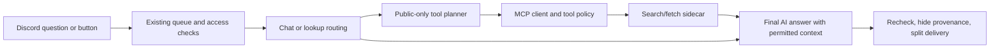

# MCP integration design — Discord AI Companion

> Implementation update, 2026-10-28: the original proposal below is historical. See [MCP_RUNTIME.en.md](MCP_RUNTIME.en.md) for implemented scope and deliberate simplifications: bounded JSON planning instead of native tool_calls; actual commands are /mcp channel and /mcp status.

2026-10-28 · Source checkpoint `95e3c72` · Design only: no MCP packages, services or live-bot changes in this task.

The owner selected **hybrid mode by default when MCP is enabled for a channel**: automatic lookups when needed, a contextual search button, and the existing per-person/channel banter tone. Implementation scope and search-provider selection must be explicit before installing new dependencies/services.

The owner subsequently selected **no additional API key**. DuckDuckGo MCP is the initial spike candidate; Brave is a later alternative. Keep the existing chat model. Published-version compatibility and real-network search remain activation gates.

## Experience and scope

| Situation | Intended behavior |
|---|---|
| A named game's latest patch/news/current price | Look up fresh information and answer briefly in the existing tone |
| “Read this URL” | Fetch the supplied public webpage |
| Banter or conversational continuation | Use existing context; no search just because the bot replies |
| “Search the web more 🌐” button | Queue another scoped search after current permission/quota checks |
| A query derived from yesterday's chat or personal memory | Preview/edit the exact external query before confirmation |
| “Where did that come from?” | Return retained eligible provenance without another search/model call |
| Lookup/server failure | Say the lookup failed; do not fabricate results or claim verification |

Default Discord triggers, ephemeral `/ask`, hidden sources and complete multipart delivery remain. Interjections do not call MCP in the first release. No image/voice work is included.

## Modes

- `off`: no web tools.
- `button`: explicit search request or button only.
- `auto`: look up questions needing external information.
- `hybrid`: auto plus contextual search-more buttons, **selected by the owner**.

MCP starts disabled globally and for every channel. Enabling a channel without an explicit mode selects hybrid. Buttons are contextual rather than added under every joke/message; tool use never raises the configured tone level.

## Server selection

[awesome-mcp-servers](https://github.com/punkpeye/awesome-mcp-servers) is a discovery catalog. Review/pin individual implementations; do not install the whole list or automatically trust new entries.

| Candidate | Role | Prerequisite |
|---|---|---|
| [DuckDuckGo community MCP](https://github.com/nickclyde/duckduckgo-mcp-server) | Search and public page reading; documented setup has no search-service key | Candidate for a no-additional-key setup, pending published-version and real-network checks |
| [Reference Fetch server](https://github.com/modelcontextprotocol/servers/tree/main/src/fetch) | URL reading alternative | Stdio requires an adapter in the isolated sidecar for HTTP clients |
| [Brave Search MCP](https://github.com/brave/brave-search-mcp-server) | Search API alternative | Owner-provided/selected key and service budget |

No candidate is installed or live-tested here. No-key setup is not a guarantee of unlimited/free service or unblocked results. The community server documents network limitations and a DNS-rebinding residual risk requiring enforcement/testing. Never automatically subscribe to or switch to a paid provider.

Expose only `web.search` and `web.fetch` adapters initially. Arbitrary shell/filesystem, bot databases, GitHub writes, purchases and message-sending MCP tools are outside the MVP.

## Architecture

The existing `Companion.process()` owns request lifecycle/revision; `eligible_channels()` continues to govern Discord disclosure. A new `ToolManager` owns discovery, approved tools, argument validation, deadlines and budgets.

Use the official Python MCP SDK and operator-fixed Streamable HTTP endpoints on a private Compose network, without host-published ports. Stdio-only implementations may use a bridge **inside the sidecar**, never Docker commands/socket access from the bot. Sidecars receive no Discord token, Groq key, bot database volume, `.env` or host files. Pin released SDK/package versions, dependency hashes and image digests after compatibility testing. Adding SDK/services requires implementation authorization; it has not happened in this design task.

## Automatic search without implicit private-chat export

1. A lightweight host route skips banter and considers current-message lookup requests, URLs and freshness questions. Historical chat links do not trigger browsing by themselves.
2. A tool-selection model, when needed, sees only the current request, time and eligible public-web session data. It never sees Discord history, person/room memory or answers containing those records.
3. It proposes approved aliases/JSON arguments. Host policy validates independently; server annotations/descriptions cannot grant permission.
4. Clear public queries/URLs from the current request run without another confirmation in auto/hybrid mode.
5. Conversation/memory-derived queries, or detected sensitive/mention/private-room data, require a local query preview/edit/confirmation. Do not send a proposed history-derived query to MCP before confirmation.
6. Final synthesis may combine tool results with already-permitted Discord context, but exposes **no callable tools**, preventing another external call from that private context.

Ambiguous references such as “that person earlier” need clarification or preview, not guessed disclosure. Pressing search does not override opt-out, channel controls or forbidden tool categories.

## Search button and preview

`SearchMoreView` binds guild/channel/requester/private mode, source question, configuration revision and a five-minute TTL. Only the original requester acts; others can ask their own question. `/ask` buttons/previews remain ephemeral.

Acknowledge promptly, then enqueue via the existing worker. Recheck cooldown/quota/pause/access; do not run long calls directly in the callback. Deduplicate repeated clicks, while allowing a clearly new retry request. A preview exposes the exact query/provider for editing and confirmation. Source edits/deletions, privacy/config/role/channel changes or expiry invalidate pending controls.

## Permissions and registration

Operators configure endpoints, capabilities and credential references locally. Discord cannot install packages, execute shell or register arbitrary endpoints. Manage Server holders can enable only operator-approved servers per channel/role. Reading Discord history does not grant every MCP capability.

Expose only actor-eligible aliases to the model; namespace names, validate schema/arguments, and pin reviewed definitions. New tools/schema changes remain disabled pending operator review/reload. Resources/prompts, private integrations and write operations need separate disclosure/action-confirmation design later.

Proposed commands, **not implemented**: `/mcp list`, `/mcp status`, `/mcp channel enabled:true mode:hybrid server:web`, `/mcp disable`. Users can continue speaking naturally or using existing `/ask`.

## Network and external content

Target URLs must be public HTTPS without embedded credentials. Deny private/loopback/link-local/metadata/local-IPv6 addresses, other schemes and forbidden redirects. Discord history URLs use the native Discord path, never fetch to bypass ACLs.

Enforce destination rules at the client **and actual server/egress connection**, including redirects. DNS preflight alone does not close rebinding gaps acknowledged by candidate servers. Keep fetch disabled if that cannot be enforced. Do not disable TLS/private-address guards to pass tests. Compose `internal:true` alone is not proof of complete host/network isolation; verify effective reachability. No host network, Docker socket or host-file mounts.

Page text, search results and tool metadata are untrusted data, never instructions to change tone/permissions, export chat, or invoke more tools. Text only initially; no file downloads, GUI or CAPTCHA workflow.

## Budgets and failures

| Proposed default | Limit |
|---|---:|
| MCP calls per question | 2, sequential |
| Per tool timeout | 10 seconds |
| Overall request deadline | 90 seconds after worker starts; existing300-second queued-job expiry remains |
| Model calls for a lookup | At most one planner and one final; explicit URLs can skip planner |
| Planner-visible tools | 4 short reviewed aliases maximum |
| Transport response | 128 KiB maximum, enforced while reading |
| Normalized results | 4 KiB per tool / 6 KiB total; actual prompt excerpt adapts to remaining budget |
| MCP requests | 6/minute and100/day per instance;10/day per person, configurable |

Every Groq call accounts for schemas, arguments, results and framing, sharing existing RPM/RPD/TPM/TPD ceilings. Planner and final share the available window; shrink context or defer instead of silently increasing limits. No autonomous loops or interjection lookups. Circuit breakers and reconnect backoff keep ordinary chat working during MCP outages. Existing Operations emits content-free alerts; distinguish failed search from a genuine empty result.

## Evidence, privacy and storage

Keep schema2 for MVP. Raw public tool text, query previews, web evidence and pending controls live in scoped RAM (30 minutes/200 sessions maximum), respecting opt-out/invalidation/restart. Do not put raw tool output into SQLite, backups or automatic memory suggestions.

Use typed `ToolEvidence`: `W1` references carry validated URL/title/fetch time/scope/dependencies; `S1` retains Discord message ID/fingerprint. Do **not** insert web URLs into existing `verify_sources()` or `Store.save_answer()`: both currently parse Discord message IDs. Extend context/conversation/rendering with a separate external-evidence field and validation path.

Hide W/S markers and unsolicited provenance. Source follow-ups merge eligible RAM web references and durable Discord references without extra AI/search calls. Expired/restarted web references must be reported unavailable rather than reconstructed. Cross-user/private evidence must not mix.

## Implementation impact

| Component | Planned impact |
|---|---|
| New `mcp_client.py`, `tool_policy.py` | SDK lifecycle, discovery, allowlist, schemas, adapters, limits |
| New `search.py`, `search_views.py` | Routing/planner, query preview and queued button actions |
| `provider.py`, `quota.py` | Tool-call envelopes, null content with calls, full request accounting |
| `app.py`, `commands.py`, `config.py` | Pipeline, kill switch, modes, admin control and invalidation |
| `context.py`, `conversation.py`, `rendering.py` | Typed external evidence, final synthesis and on-demand provenance |
| `storage.py` | Existing metadata for settings; keep web data out of Discord reference tables |
| `operations.py` | Circuit/health status and existing content-free alert path |
| Requirements/Docker/Compose | Pinned SDK/sidecars and tested transport/egress isolation |
| Tests/docs/records | Fake and loopback MCP, regression/recovery, TH/EN and rollout/rollback evidence |

## Milestones and acceptance

1. Compatibility spike: verify published SDK/server versions on Python3.12, transport/discovery, actual tool-call support for unchanged `qwen/qwen3.8-27b`, and a complete request under configured7,000TPM accounting. Groq documentation includes this model, but previous chat200 is not runtime tool-call evidence.
2. Foundation: registry/kill switch/permissions/fake-server tests; no tool enabled automatically.
3. Integrate chosen sidecar, effective URL/egress controls, hybrid/buttons/preview, typed evidence and quotas.
4. Preserve all120 existing unit cases and add new acceptance tests, real loopback MCP/HTTP and Docker resource/recovery checks. Keep rollback image/database backup before enabling the agreed bot channel.
5. Verify live current-data question/URL reading, no search for banter, requester-only controls, sources, privacy/pause/role invalidation, kill switch and rollback.

Required tests include denied actors/tools, forged/extra arguments, schema changes, injection, private-data egress, scoped evidence, duplicate/expired controls, edits during calls, timeout/429/reconnect, oversized streams/pages, IPv4/IPv6/metadata and DNS/redirect rebinding, quota exhaustion and mid-request disable.

Stop enabling components that fail compatibility/egress/privacy/quota checks. No unapproved model, paid plan or access expansion. This document has consistency review only; it claims no MCP runtime verification.

## Sources checked 2026-10-28

- [Catalog](https://github.com/punkpeye/awesome-mcp-servers)
- [Official SDK](https://github.com/modelcontextprotocol/python-sdk) and [client docs](https://py.sdk.modelcontextprotocol.io/client/)
- [Groq local tool orchestration](https://console.groq.com/docs/tool-use/local-tool-calling); provider-hosted remote orchestration is not selected
- [DuckDuckGo README](https://github.com/nickclyde/duckduckgo-mcp-server#readme) and [security model](https://github.com/nickclyde/duckduckgo-mcp-server/blob/main/SECURITY.md)
- [Fetch](https://github.com/modelcontextprotocol/servers/tree/main/src/fetch) and [Brave](https://github.com/brave/brave-search-mcp-server#readme)
