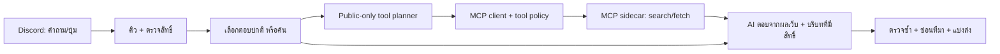

# แบบเพิ่ม MCP ให้ Discord AI Companion

> อัปเดตการลงมือ 2026-10-28: แบบด้านล่างเป็นข้อเสนอเดิม รายละเอียดรุ่นที่ทำจริงและส่วนที่ปรับลดอยู่ใน [MCP_RUNTIME.th.md](MCP_RUNTIME.th.md) ใช้ JSON planner แบบจำกัดแทน native tool_calls; คำสั่งจริง /mcp channel และ /mcp status

วันที่ 2026-10-28 · อิงโค้ด checkpoint `95e3c72` · สถานะ: เอกสารออกแบบ ยังไม่ติดตั้ง MCP/แก้บอทที่รันอยู่

เจ้าของยืนยัน **โหมดผสมเป็นค่าเริ่มต้นเมื่อเปิด MCP ให้ห้อง**: ค้นเองเมื่อจำเป็น มีปุ่มค้นเพิ่ม และคุยกวนตามค่าห้อง/คนเดิม ขอบเขตการลงมือและผู้ให้บริการค้นเว็บต้องชัดเจนก่อนติดตั้ง dependency/บริการใหม่

เจ้าของเลือกเริ่มจาก **ไม่ต้องมี API key เพิ่ม** แล้ว: ใช้ DuckDuckGo MCP เป็นตัวเลือกตั้งต้นสำหรับ spike; Brave เป็นทางเลือกภายหลัง ไม่เปลี่ยนโมเดลคุยเดิม ยังต้องยืนยันรุ่นที่ติดตั้งได้และผลค้นจริงก่อนเปิดใช้งาน

## 1. ผลที่ผู้ใช้จะเห็น

| ข้อความ/การกระทำ | การตอบที่ออกแบบไว้ |
|---|---|
| “แพตช์ล่าสุดเกมนี้มีอะไร” โดยระบุชื่อเกมในคำถาม | ค้นข้อมูลใหม่แล้วสรุปสั้น ๆ ตามโทนเดิม |
| “อ่านลิงก์นี้ให้หน่อย https://…” | เปิดหน้าเว็บสาธารณะที่ให้มาแล้วตอบ |
| คุยเล่น/แซว/“อันที่สองล่ะ” ในบทสนทนาเดิม | ใช้บริบทเดิม ไม่มีการค้นเว็บเพียงเพราะบอทตอบ |
| กด “ค้นเว็บเพิ่ม 🌐” ใต้คำตอบ | ค้นเพิ่มจากคำถามนั้นผ่านคิวเดิมและตรวจสิทธิ์ใหม่ |
| “เอาเรื่องที่เมื่อวานเราคุยกันไปหาเพิ่ม” | ให้ดู/แก้คำค้นก่อนส่งข้อมูลจากประวัติไปบริการค้นหา |
| “เอามาจากไหน” | แสดงที่มาเดิมที่ยังใช้ได้ ไม่เรียก AI/ค้นเว็บใหม่ |
| เว็บหรือ MCP ใช้ไม่ได้ | แจ้งว่าค้นไม่สำเร็จ ไม่แต่งผลค้นหรืออ้างว่าเช็กแล้ว |

ยังตอบเมื่อแท็ก/ตอบกลับและคุยเต็มที่ในห้องบอทตามเดิม บอทไม่ค้นทุกข้อความที่เห็น และไม่เรียก MCP จากการแทรกคุยเองในรุ่นแรก คำตอบยาวยังแบ่งส่ง; ที่มายังซ่อนจนกว่าจะถาม

## 2. โหมดรายห้อง

| โหมด | พฤติกรรม |
|---|---|
| `off` | ไม่เรียกเครื่องมือเว็บ |
| `button` | รอผู้ใช้กดค้นหรือสั่งค้นชัดเจน |
| `auto` | ตัดสินใจค้นเมื่อคำถามต้องใช้ข้อมูลภายนอก |
| `hybrid` | auto พร้อมปุ่มค้นเพิ่มในคำตอบที่เกี่ยวข้อง — เจ้าของเลือกโหมดนี้ |

MCP ปิดทั้ง instance และทุกห้องก่อน operator ติดตั้ง/เปิดใช้ หลังแอดมินเปิดห้องโดยไม่ระบุโหมด ใช้ `hybrid` ปุ่มไม่อยู่ใต้มุกหรือทุกข้อความโดยอัตโนมัติ และไม่เพิ่มความหยาบเกินค่า tone ที่ตั้งไว้

## 3. เชื่อมกับ repo ที่ส่งมาอย่างไร

[awesome-mcp-servers](https://github.com/punkpeye/awesome-mcp-servers) เป็นสารบัญ เลือก server รายตัวมาตรวจและ pin รุ่น ไม่ clone ทั้งรายการมาติดตั้งหรือเชื่อถือการเพิ่มรายการใหม่โดยอัตโนมัติ

| ตัวเลือกตั้งต้น | หน้าที่ | เงื่อนไขก่อนเปิด |
|---|---|---|
| [nickclyde/duckduckgo-mcp-server](https://github.com/nickclyde/duckduckgo-mcp-server) | ค้นเว็บและอ่านหน้าเว็บ; ตัวอย่างติดตั้งไม่ต้องใส่คีย์บริการค้นหา | ผู้สมัครแบบไม่เพิ่ม API key; ต้องทดสอบว่าค้นได้จริงจาก Docker/เครือข่ายนี้และตรวจรุ่นที่เผยแพร่ |
| [modelcontextprotocol/server-fetch](https://github.com/modelcontextprotocol/servers/tree/main/src/fetch) | อ่าน URL โดยเฉพาะ | ตัวเลือกแทนส่วนอ่านหน้าเว็บ; stdio ต้องมีตัวเชื่อมใน sidecar หาก client ใช้ HTTP |
| [brave/brave-search-mcp-server](https://github.com/brave/brave-search-mcp-server) | ค้นเว็บผ่าน API | ทางเลือกเมื่อเจ้าของมี/เลือกคีย์และเพดานบริการเอง ไม่เปิดแพ็กเกจหรือสลับไปเสียเงินเอง |

ยังไม่ได้เลือกหรือทดสอบ server ใดใน runtime จริง การไม่มี API key เพิ่มไม่ได้แปลว่าไม่มีข้อจำกัดการค้น ไม่รับประกันใช้ฟรีตลอดหรือผลค้นไม่ถูกบล็อก ตัวเลือก DuckDuckGo เป็นงานชุมชน; เอกสารระบุข้อจำกัดบางเครือข่ายและความเสี่ยง DNS rebinding ที่ต้องแก้/ทดสอบก่อนเปิดอ่าน URL

รุ่นแรกใช้เฉพาะความสามารถ `web.search` และ `web.fetch` ผ่าน adapter จึงเปลี่ยน server ได้โดยไม่เปลี่ยนวิธีคุย ไม่เปิด shell, filesystem, ฐานข้อมูลบอท, งานเขียน GitHub, การซื้อสินค้า หรือเครื่องมือส่งข้อความผ่าน MCP

## 4. โครงสร้างที่เสนอ

- `Companion.process()` ยังเป็นเจ้าของวงจรคำถามและ revision; `eligible_channels()` ยังควบคุมประวัติข้ามห้อง
- `ToolManager` ใหม่ทำ discovery, รายการอนุญาต, ตรวจ schema/arguments, จำกัดเวลา/จำนวน และคืนผลแบบมีชนิดข้อมูล
- ใช้ official Python MCP SDK กับ Streamable HTTP ไปยัง sidecar ที่กำหนดไว้ สื่อสารเฉพาะเครือข่าย Compose ไม่มีพอร์ตเผยออก host
- stdio รองรับผ่าน adapter ภายใน sidecar เมื่อจำเป็น ไม่เรียก `docker run` หรือ mount Docker socket จากตัวบอท
- sidecar ไม่มี token Discord, คีย์ Groq, volume ฐานข้อมูล, `.env` หรือไฟล์โฮสต์ของบอท มีเฉพาะคีย์ที่ server นั้นจำเป็นต้องใช้
- pin dependency hashes และ image digest หลัง compatibility spike; ใช้ SDK API ของรุ่นที่ pin จริง ไม่คัดโค้ดต่างรุ่นมาปน

การเพิ่ม sidecar/SDK เป็นการเปลี่ยน dependency และโครงสร้างที่ต้องอยู่ในแผนลงมือที่อนุมัติ ไม่ใช่ผลที่ติดตั้งแล้วจากเอกสารนี้

## 5. ค้นเองได้โดยไม่ส่งประวัติไปค้นโดยพลการ

1. Host ตรวจรูปแบบเบื้องต้นเพื่อข้ามการคุยเล่น และพิจารณาคำถามข้อมูลสด/คำสั่งค้น/URL ไม่เปิดเว็บเพียงเพราะมีลิงก์ในแชทเก่าที่ค้นเจอ
2. ถ้าต้องให้ AI เลือกเครื่องมือ ใช้ planner ที่เห็นเฉพาะคำถามปัจจุบัน เวลา และข้อมูลเว็บสาธารณะที่ใช้ได้ใน session นั้น **ไม่เห็นประวัติ Discord, ความจำคน/ห้อง หรือคำตอบที่ผสมข้อมูลเหล่านั้น**
3. Planner เสนอเฉพาะ tool alias ที่อนุญาตและ JSON arguments; host ตรวจอีกครั้ง ไม่เชื่อ `readOnlyHint` หรือคำอธิบายจาก server ว่าให้สิทธิ์เองได้
4. คำค้น/URL ที่มาจากข้อความปัจจุบันและชัดว่าเป็นข้อมูลสาธารณะเรียกได้ทันทีใน `auto/hybrid` ไม่ถามย้ำทุกครั้ง
5. ถ้าต้องใช้ข้อมูลในบทสนทนาเดิม/ความจำ หรือมีชื่อคน mention ห้องลับ พิกัดละเอียด/ค่าที่ตรวจพบว่าอ่อนไหว ให้เปิด preview ที่แก้คำค้นได้ก่อน คำค้นที่เสนอจากบริบทห้ามส่งไป MCP จนผู้ถามยืนยัน query นั้น
6. AI ขั้นตอบสุดท้ายเห็นผลเว็บในฐานะข้อมูลอ้างอิงที่ไม่น่าเชื่อถือร่วมกับบริบท Discord ที่ผ่านสิทธิ์แล้ว ขั้นนี้ไม่เปิด tool calling จึงไม่สามารถส่งบริบทนั้นออกไปเป็นคำค้นรอบถัดไป

คำถามที่อ้าง “อันนั้น/คนเมื่อกี้” แต่ไม่มีข้อมูลสาธารณะพอให้ค้น ต้องขอความชัดเจนหรือ preview ไม่เดาว่าต้องส่งอะไรออกจากห้อง `button` เป็นการยืนยันค้น ไม่ได้ยกเว้นการปิดเก็บข้อมูล สิทธิ์ห้อง หรือชนิดเครื่องมือที่ห้ามใช้

## 6. ปุ่มค้น

`SearchMoreView` ผูกกับ guild/channel/requester/private flag, คำถามต้นทาง, server/tool configuration revision และอายุ 5 นาที ผู้ถามเป็นคนกดได้เท่านั้น คนอื่นถามบอทเองได้ ปุ่มใน `/ask` และ preview เป็น ephemeral

กดแล้ว acknowledge interaction ทันที จากนั้นเข้าคิวเดิม ตรวจ cooldown, quota, pause และสิทธิ์อีกครั้ง ไม่มี HTTP/AI call ทำงานยาวอยู่ใน callback การกดย้ำไม่ส่งงานซ้ำ และ retry ที่อนุญาตต้องเป็นคำขอใหม่ที่เห็นสถานะชัดเจน

ใช้ preview + confirm ภายใน 5 นาทีสำหรับข้อมูลจากประวัติ ผู้ถามตรวจคำค้นและปลายทางบริการได้ แก้/ลบต้นทาง ปิด MCP ปิดเก็บข้อมูล เปลี่ยน role/channel หรือหมดอายุ ทำให้ปุ่มใช้ต่อไม่ได้

## 7. สิทธิ์และการเพิ่ม server

- Operator กำหนด server endpoints, capabilities และ credential references จากไฟล์ local; ไม่มีคำสั่ง Discord ติดตั้ง package, ป้อน shell หรือเพิ่ม arbitrary endpoint
- แอดมิน Manage Server เปิดได้เฉพาะ server ที่ operator อนุญาต และกำหนดห้อง/role ที่ใช้ได้ การมีสิทธิ์อ่านแชทไม่ได้ให้สิทธิ์ MCP ทุกตัว
- ส่งคำนิยามให้โมเดลเฉพาะเครื่องมือที่ผู้ถามใช้ได้ ตรวจชื่อแบบ namespace ไม่ชนกัน และตรวจ arguments กับ schema ที่ pin ไว้
- เครื่องมือใหม่/เปลี่ยน schema ไม่เปิดเองหลัง reconnect รอตรวจและ reload configuration
- MCP resources/prompts, private-file access และเครื่องมือเขียนข้อมูลเป็นงานภายหลัง ต้องออกแบบ disclosure/การยืนยันเฉพาะ action ก่อน

คำสั่งที่เสนอ (ยังไม่มีในตัวบอท): `/mcp list`, `/mcp status`, `/mcp channel enabled:true mode:hybrid server:web`, `/mcp disable` การอ่านลิงก์/ค้นธรรมดาใช้ข้อความปกติหรือ `/ask` เดิม ไม่บังคับจำคำสั่งใหม่

## 8. เครือข่ายและเนื้อหาเว็บ

URL เป้าหมายอนุญาต HTTPS สาธารณะเท่านั้น ปฏิเสธ credentials ใน URL, private/loopback/link-local/metadata/IPv6-local, scheme อื่น และ redirect ไปปลายทางต้องห้าม URL Discord history ใช้ทางอ่าน Discord เดิม ไม่ให้ fetch ไปเลี่ยง ACL

ตรวจที่ client และ server/egress guard ทุก redirect และที่ IP ที่เชื่อมต่อจริง DNS precheck อย่างเดียวไม่ปิดช่อง DNS rebinding; upstream fetch candidates ยอมรับข้อจำกัดนี้ ต้องมีการทดสอบ/บังคับ egress เพิ่ม หากปิดช่องนี้ไม่ได้ให้ `fetch` คงปิดอยู่ ไม่ปิด TLS verification หรือ guard เพื่อให้ทดสอบผ่าน

Network `internal:true` อย่างเดียวไม่ใช่คำรับรองว่าปิด host/ทุกเครือข่ายแล้ว ต้องตรวจผลจริง ไม่มี host network, Docker socket หรือ filesystem mount ที่ใช้ข้ามขอบเขตได้

ผลค้น ข้อความเว็บ tool description และ embedded instructions เป็นข้อมูล ไม่ใช่คำสั่ง ห้ามเปิดสิทธิ์/ส่งแชท/เปลี่ยน tone/เรียกเครื่องมืออื่นตามข้อความในเว็บ รับ text เป็นหลัก ไม่ดาวน์โหลดไฟล์หรือใช้ GUI/CAPTCHA ในรุ่นแรก

## 9. งบและการล้มเหลว

| ขอบเขตที่เสนอ | ค่าเริ่มต้น |
|---|---:|
| MCP calls ต่อคำถาม | 2 แบบเรียงลำดับ |
| เวลาแต่ละ tool call | 10 วินาที |
| เวลารวมงาน | 90 วินาทีหลัง worker เริ่มงาน; งานรอคิวเกิน300วินาทีหมดอายุตามเดิม |
| AI calls สำหรับค้น | สูงสุด 1 planner + 1 final; ลิงก์ชัดเจนอาจข้าม planner |
| รายการเครื่องมือที่ส่งให้ planner | ไม่เกิน 4, ส่ง alias สั้นที่ตรวจแล้ว |
| transport response | ไม่เกิน 128 KiB วัดระหว่างอ่าน |
| ข้อมูลผลลัพธ์ | 4 KiB ต่อ tool / 6 KiB รวม; ใส่ใน prompt ตามงบที่เหลือจริง |
| MCP requests | 6/นาทีและ100/วันต่อ instance; 10/วันต่อคน เป็นค่าตั้งต้นที่ปรับได้ |

Groq ทุก call รวม tool schema, arguments/results และข้อความระบบในการ reserve quota คง RPM/RPD/TPM/TPD เดิม ไม่เพิ่มเพดานเอง งบ planner/final ใช้ร่วมกันและลดบริบทก่อนส่ง หากไม่พอตอบว่าต้องรอ ไม่วน tool calls จนชน rate limit

ไม่มี autonomous loop ไม่กดปุ่ม/ค้นจากการแทรกคุยเอง ใช้ circuit breaker และ reconnect backoff; server ล่มไม่ทำให้แชทปกติล่ม แจ้งแอดมินผ่านระบบ Operations เดิมโดยไม่มี query/ผลเว็บ/คีย์ใน log บอกความล้มเหลวต่างจาก “ค้นแล้วไม่พบ”

## 10. ที่มา ความจำ และ SQLite

คง schema2 สำหรับ MVP: public tool text, query previews, web refs และ pending buttons อยู่ใน RAM แยก guild/channel/requester/private อายุสูงสุด30นาที/200 sessions และล้างตาม privacy/invalidation/restart ไม่ใส่ raw tool output ใน SQLite, backup หรือ memory suggestion

`ToolEvidence` ต้องแยกจาก Discord references: web label `W1` เก็บ URL ที่ผ่าน validation/title/fetched_at/scope/dependency; Discord label `S1` ยังคง message ID/fingerprint ไม่ส่ง URL เว็บเข้า `verify_sources()` หรือ `Store.save_answer()` เดิม เพราะสองจุดนั้น parse Discord message IDs

Renderer ซ่อนทั้ง W/S labels และที่มาที่ไม่ได้ขอ คำตอบที่มีทั้งเว็บและแชทตรวจ disclosure ตามแต่ละชนิด เมื่อถามที่มาใช้ RAM web refs และ DB Discord refs พร้อมสิทธิ์ปัจจุบัน ไม่ค้นใหม่ หาก web refs หมดอายุ/รีสตาร์ตให้บอกตามจริง ปุ่มค้นและหลักฐานเว็บของแต่ละคนไม่ปนกันในห้องเดียวกัน

## 11. ผลกระทบโค้ดเมื่อเริ่มลงมือ

| ส่วน | การเปลี่ยนที่คาดไว้ |
|---|---|
| `bot/mcp_client.py`, `bot/tool_policy.py` ใหม่ | SDK transport/lifecycle, discovery, allowlist, validation, adapter และ budgets |
| `bot/search.py`, `bot/search_views.py` ใหม่ | routing/planner, query preview, ปุ่มค้นและคิว |
| `provider.py`, `quota.py` | tool-call envelope, null content + tool calls, argument validation, reserve ทั้ง schema/ผล และทุก AI call |
| `app.py`, `commands.py`, `config.py` | ผูก pipeline, kill switch, modes, admin controls, state invalidation |
| `context.py`, `conversation.py`, `rendering.py` | typed web evidence, safe final synthesis และ refs-on-request |
| `storage.py` | ตั้งค่า mode/allowlist โดยใช้ metadata เดิม; ไม่ยัดเว็บลงตาราง message refs |
| `operations.py` | health/failures/circuit status และแจ้งเตือนเดิม |
| requirements/Docker/Compose | official MCP SDK ที่ pin, sidecar ที่ pin, transport/egress isolation ไม่มี host ports |
| tests/guides/records | fake MCP, actual loopback MCP, regression, TH/EN guides, rollout/rollback |

## 12. ลำดับทำและเกณฑ์รับงาน

1. **Compatibility spike:** ตรวจ SDK release ที่ติดตั้งได้บน Python3.12, transport/discovery กับ server ที่เลือก, model เดิม `qwen/qwen3.8-27b` คืน tool calls ได้จริง, และต้นทุนทั้งคำถามอยู่ใน7,000 TPM ที่ตั้งไว้ ไม่ถือว่า chat200เดิมยืนยัน tool calling แล้ว เอกสาร Groq มีตัวอย่างโมเดลนี้ แต่ runtime ยังต้องพิสูจน์
2. **MCP foundation:** kill switch/registry/permissions/fake server tests ไม่มี server ใหม่เปิดเอง
3. **ค้นจริง:** sidecar + server ที่เลือก, URL/egress guards, โหมดผสมและปุ่ม/preview, typed evidence และ quota
4. **ก่อน deploy:** เทสต์เดิม120กรณียังผ่าน + เพิ่มเกณฑ์ใหม่, loopback MCP/HTTP และ Docker memory/backup/restore ผ่าน เก็บ image/backup เดิม แล้วเปิดเฉพาะห้องบอทที่ตกลง
5. **ตรวจจริง:** ค้นคำถามข้อมูลสดและอ่าน URL ได้, คุยเล่นไม่ค้น, กดค้น/ยืนยันได้เฉพาะเจ้าตัว, ขอที่มาได้, pause/privacy/role change ยกเลิกงานและล้าง RAM, ตรวจ kill switch/rollback

กรณีบังคับทดสอบ: denied user/server/tool, forged/extra arguments, changed schema, prompt injection, private-data egress, cross-user/cross-private refs, duplicate/expired button, source edit during call, timeout/429/reconnect, oversized result/HTML, DNS/redirect rebinding, IPv4/IPv6/metadata targets, exhausted quotas และ server ถูกปิดระหว่างงาน

หยุดเปิดส่วนที่ไม่ผ่าน compatibility/egress/privacy/quota; ไม่เปลี่ยนโมเดล คีย์ แพ็กเกจเสียเงิน หรือขยายสิทธิ์เพื่อให้ผ่านโดยไม่ตกลงกับเจ้าของ การเขียนแบบนี้ตรวจความสอดคล้องเอกสารเท่านั้น ยังไม่มีผลทดสอบ MCP runtime ให้กล่าวอ้าง

## แหล่งข้อมูลที่ตรวจ 2026-10-28

- [Catalog](https://github.com/punkpeye/awesome-mcp-servers): ใช้เลือก implementation รายตัว
- [Official Python SDK](https://github.com/modelcontextprotocol/python-sdk) / [Client](https://py.sdk.modelcontextprotocol.io/client/): transport และ client integration
- [Groq local tool calling](https://console.groq.com/docs/tool-use/local-tool-calling): host เป็นผู้รันเครื่องมือ ต่างจาก provider-hosted remote orchestration ที่ไม่เลือกใช้ในแบบนี้
- [DuckDuckGo server README](https://github.com/nickclyde/duckduckgo-mcp-server#readme) / [Security](https://github.com/nickclyde/duckduckgo-mcp-server/blob/main/SECURITY.md): ตัวเลือกค้น/อ่านและข้อจำกัดที่ต้องทดสอบ
- [Fetch README](https://github.com/modelcontextprotocol/servers/tree/main/src/fetch) / [Brave README](https://github.com/brave/brave-search-mcp-server#readme): ทางเลือกที่ยังไม่ได้ติดตั้ง
